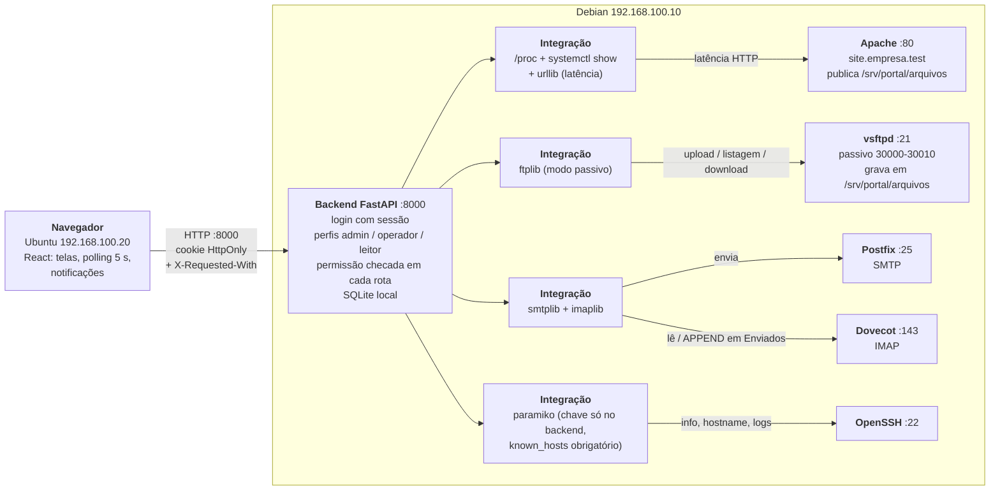

# Arquitetura

Navegador (Ubuntu) → Backend FastAPI (Debian, porta 8000) → camada de integração → serviços.
O navegador **só** fala com o backend; as credenciais de FTP, e-mail e a chave SSH ficam no
servidor (`backend/.env` e `~/.ssh`), nunca no frontend nem no Git.

| Camada | Tecnologia | Responsabilidade |
|---|---|---|
| Navegador | React + Vite + Chart.js | Telas, polling de 5 s, notificações, lista de operações da sessão |
| Backend | FastAPI, SQLite, Argon2id | Login com sessão, perfis, **autorização em cada rota**, orquestração |
| Integração | `/proc`, `systemctl show`, `ftplib`, `smtplib`, `imaplib`, `paramiko` | Falar com cada serviço; validar entradas; classificar erros |
| Serviços | Apache, vsftpd, Postfix, Dovecot, OpenSSH | Os serviços reais do Debian |

Fluxo do upload (CP3): navegador → `POST /api/files/upload` → valida nome/extensão/tamanho →
SHA-256 do original → `ftplib` (STOR em arquivo temporário + RNTO) → RETR e SHA-256 do recuperado →
GET no Apache e SHA-256 do publicado → resposta com os três hashes.
